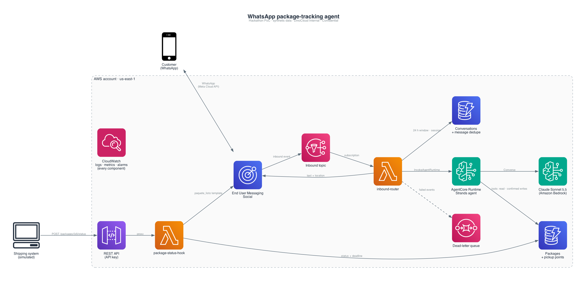

# HOP · WhatsApp package agent on AWS

> AWS CDS Agentic AI Hackathon, October 2026 · a DinoCloud project · all data is synthetic

An agentic WhatsApp assistant for **HOP**, a network of neighbourhood pickup points in Argentina. Customers get told when their package is ready, ask where it is, and sort out the pickup themselves: more time, another pickup point, a new delivery date, or a return. Built on **AWS End User Messaging Social** (WhatsApp) and **Amazon Bedrock AgentCore**, fully serverless, defined in AWS CDK.

Today HOP reaches customers through CSV campaigns pushed through a middleware, and its chatbot never covered end-customer cases. This project moves both to native AWS messaging and an agent that resolves the request in the chat.

**Demo video**: _link added on submission_ · **Try it**: [usage guide](docs/usage-guide.md) (the number, 13 messages to send, what should happen).

## What it does

| Flow | Trigger | What happens |
| --- | --- | --- |
| **Proactive notice** | The shipping system reports a package as ready at a pickup point | The customer receives an approved WhatsApp template: "your package is ready, you have N days" |
| **Tracking** | The customer writes "Where is my package?" | The agent answers with status, pickup point, opening hours and deadline, plus a map pin of the pickup point |
| **Self-service resolution** | The customer replies to the notice | The agent extends the deadline, changes the pickup point, reschedules the delivery or returns the package, always previewing and asking for a yes before writing |
| **Sending** (demo) | "I want to send a package" / "I dropped it off" | Registers the package in transit, then marks it ready for pickup and starts the deadline |

The agent only ever sees the packages linked to the phone it is talking to, confirms every change before writing it, and never invents a location: the map pin is built by the server from the database.

## Architecture



```
Shipping system ─POST /packages/{id}/status (API key)─► API Gateway ─► Lambda package-status-hook ─► DynamoDB
                                                                                     └─► End User Messaging Social (template) ─► WhatsApp

WhatsApp ─► End User Messaging Social ─► SNS ─► Lambda inbound-router ─► AgentCore Runtime (Strands agent, TypeScript) ─► DynamoDB (tools)
                                                      ├─► DynamoDB (exactly-once dedupe, 24-hour window, session)
                                                      └─► End User Messaging Social (text + location) ─► WhatsApp
```

- **AWS End User Messaging Social** handles WhatsApp end to end: templates for business-initiated messages, text and location messages, and every inbound webhook delivered to SNS.
- **Amazon Bedrock AgentCore Runtime** runs the agent with **direct code deploy** (`NODE_22`): an esbuild bundle uploaded as a CDK asset, no container, one isolated session per conversation. The agent is built with Strands Agents (TypeScript) on Claude via a Bedrock inference profile.
- **Lambda + DynamoDB** do the rest: an idempotent status hook behind API Gateway, and an inbound router that processes each message exactly once and never replies twice.
- **One CDK stack**, least-privilege IAM, cdk-nag on every build, JSON logs with masked phones, a metric and an alarm for every failure path, GitHub Actions deploying `main` through OIDC.

Design, flows, guarantees and trade-offs: [docs/architecture.md](docs/architecture.md).

## How to run

Requirements: Node.js 22+, npm, AWS CLI v2. No Docker.

```bash
git clone git@github.com:dinocloud/hop.git && cd hop
npm ci
npm run typecheck && npm run lint && npm run format:check   # static checks
npm test                                                   # 200+ unit and infra tests
npm run build:agent && npm run smoke:agent                 # bundle the agent and load it like the runtime does
npm run synth                                              # cdk synth --strict with cdk-nag, no credentials needed
```

Deploying is done by the pipeline when a pull request merges to `main`. Seed data, trying each flow (WhatsApp, synthetic events, the status hook, the agent alone), watching logs and alarms, troubleshooting and cleanup are all in **[docs/how-to-run.md](docs/how-to-run.md)**.

## Repository layout

```
infra/            CDK app: hop-stack.ts (the application) · ci-stack.ts (GitHub OIDC deploy role)
src/lib/          shared code: WhatsApp sender, DynamoDB repos, inbound-event parser, agent contract, phone/time helpers
src/lambdas/      package-status-hook (API Gateway) · inbound-router (SNS)
agent/            the agent for AgentCore Runtime: server, agent, tools, actions, esbuild bundle
scripts/          seed, add-package, send-test, publish-inbound, smoke-agent
templates/        WhatsApp template definition (paquete_listo)
test/             vitest: unit tests with mocked AWS, infra tests on the synthesized template
docs/             how-to-run, architecture, usage guide, E2E runbook and demo script, Spanish technical reference
.github/          ci.yml (validate every branch) · deploy.yml (deploy main)
```

## Documentation

| Document | For whom |
| --- | --- |
| [How to run](docs/how-to-run.md) | Anyone cloning the repo: install, check, deploy, seed, try, watch, troubleshoot |
| [Architecture](docs/architecture.md) | Reviewers: components, data model, flows, reliability and security guarantees, decisions |
| [Usage guide](docs/usage-guide.md) | Testers with a phone: what to send and what should happen |
| [E2E runbook and demo script](docs/e2e-y-demo.md) | The team: verified end-to-end runs and the presentation script (Spanish) |
| [Technical reference](docs/referencia-tecnica.md) | The team: every detail of the stack, the hook, the agent and observability (Spanish) |
| [Contributing](CONTRIBUTING.md) | Contributors: workflow, checks, conventions, rules of the shared account |

## Status

Deployed in the DinoCloud dev account and verified end to end on a real WhatsApp number: proactive notice, tracking with location pin, and the four resolution actions. Known limitations (message ordering under bursts, runtime log retention, demo-only sending tools) are listed in the [architecture doc](docs/architecture.md#known-limitations-and-next-steps).

## Team

DinoCloud AppDev practice: Nicolás Grondona (TL), Santiago Larsen, Leandro Espíndola, Rocco Sittoni, with Lucas Donadio. Built for the AWS CDS Agentic AI Hackathon on a synthetic dataset; no HOP code, data or customers are used.

## License

MIT. See [LICENSE](LICENSE).
